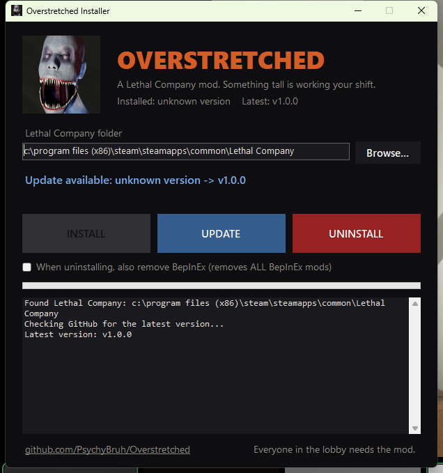

  

<h1 align="center">Overstretched</h1>

<i>A Lethal Company mod. Something tall is working your shift.</i>

---

## Install (the easy way)

1. Download **`OverstretchedInstaller.exe`** from the [latest release](https://github.com/PsychyBruh/Overstretched/releases/latest).
2. Run it. It finds Lethal Company through Steam on its own.
3. Tick the mod pack groups you want, then click **INSTALL**. It sets up BepInEx (the mod loader) if you
   don't have it, then installs Overstretched and the mod pack.

Later, open it again and click **UPDATE** when a new version is out (only changed mods are downloaded,
your settings are kept), or **UNINSTALL** to remove exactly what it installed. The installer updates
itself too.

**Coming from 1.x?** Click UPDATE in your old installer like always. When you start the game, Overstretched
offers to install the mod pack: it opens the new installer, and the pack goes in as soon as you close the game.

> **Windows may say "Windows protected your PC".** The installer isn't code-signed (that costs money).
> Click **More info → Run anyway**. The full source is in this repo if you want to check it.

**Everyone in your lobby needs Overstretched and the same mod pack groups.** If someone's mods don't match,
the host gets a warning naming what's missing.

Manual install

1. Install [BepInEx 5](https://github.com/BepInEx/BepInEx/releases) into your Lethal Company folder.
2. Download `Overstretched.dll` from the latest release.
3. Put it in `Lethal Company/BepInEx/plugins/Overstretched/`.

## The mod pack

Overstretched also installs a curated pack of other creators' mods, all checked to load together on Lethal
Company v81. You pick the groups in the installer; the F8 menu's **Mods** tab shows every mod
with its author, license and links, lets you switch mods off or on (applies at the next launch), and edits
their settings.

| Group | Mods |
|---|---|
| **Core** | [darmuhsTerminalStuff](https://thunderstore.io/c/lethal-company/p/darmuh/darmuhsTerminalStuff/) by darmuh, [LethalLevelLoader](https://thunderstore.io/c/lethal-company/p/IAmBatby/LethalLevelLoader/) by IAmBatby, [WeatherRegistry](https://thunderstore.io/c/lethal-company/p/mrov/WeatherRegistry/) by mrov, [NestFix](https://thunderstore.io/c/lethal-company/p/PureFPSZac/NestFix/) by PureFPSZac, [LethalCompany InputUtils](https://thunderstore.io/c/lethal-company/p/Rune580/LethalCompany_InputUtils/) by Rune580, [FairAI](https://thunderstore.io/c/lethal-company/p/TheFluff/FairAI/) by TheFluff |
| **Tolian Moons** | [Tolian Moons](https://thunderstore.io/c/lethal-company/p/Tolian/Tolian_Moons/) by Tolian |
| **Mirage** | [Mirage](https://thunderstore.io/c/lethal-company/p/qwbarch/Mirage/) by qwbarch |
| **Bigger lobbies** | [LobbyControl](https://thunderstore.io/c/lethal-company/p/mattymatty/LobbyControl/) by mattymatty, [MoreCompany](https://thunderstore.io/c/lethal-company/p/notnotnotswipez/MoreCompany/) by notnotnotswipez |
| **Monsters** | [ImmortalSnail](https://thunderstore.io/c/lethal-company/p/AmesBoys/ImmortalSnail/) by AmesBoys, [ClaySurgeonOverhaul](https://thunderstore.io/c/lethal-company/p/dopadream/ClaySurgeonOverhaul/) by dopadream, [Moonswept](https://thunderstore.io/c/lethal-company/p/MoonsweptTeam/Moonswept/) by MoonsweptTeam, [SCP1507](https://thunderstore.io/c/lethal-company/p/ProjectSCP/SCP1507/) by ProjectSCP, [SCP966](https://thunderstore.io/c/lethal-company/p/ProjectSCP/SCP966/) by ProjectSCP, [RollingGiant](https://thunderstore.io/c/lethal-company/p/SoftDiamond/RollingGiant/) by SoftDiamond, [Biodiversity](https://thunderstore.io/c/lethal-company/p/super_fucking_cool_and_badass_team/Biodiversity/) by super_fucking_cool_and_badass_team, [Mimics](https://thunderstore.io/c/lethal-company/p/x753/Mimics/) by x753, [Peepers](https://thunderstore.io/c/lethal-company/p/x753/Peepers/) by x753, [Locker](https://thunderstore.io/c/lethal-company/p/zealsprince/Locker/) by zealsprince, [ToilHead](https://thunderstore.io/c/lethal-company/p/Zehs/ToilHead/) by Zehs |
| **Items** | [OuijaBoard](https://thunderstore.io/c/lethal-company/p/Electric131/OuijaBoard/) by Electric131, [SellBodiesFixed](https://thunderstore.io/c/lethal-company/p/Entity378/SellBodiesFixed/) by Entity378, [Remnants](https://thunderstore.io/c/lethal-company/p/KawaiiBone/Remnants/) by KawaiiBone, [EliteFlashlight](https://thunderstore.io/c/lethal-company/p/MissileMann/EliteFlashlight/) by MissileMann, [LethalPhones](https://thunderstore.io/c/lethal-company/p/Scoops/LethalPhones/) by Scoops, [LCGoldScrapMod](https://thunderstore.io/c/lethal-company/p/SimonTendo/LCGoldScrapMod/) by SimonTendo, [Whiteboard](https://thunderstore.io/c/lethal-company/p/Zehs/Whiteboard/) by Zehs |
| **Interiors** | [LiminalPools](https://thunderstore.io/c/lethal-company/p/theMenagerie/LiminalPools/) by theMenagerie |
| **Emotes & suits** | [TooManyEmotes](https://thunderstore.io/c/lethal-company/p/FlipMods/TooManyEmotes/) by FlipMods, [TooManyEmotesScrap](https://thunderstore.io/c/lethal-company/p/FlipMods/TooManyEmotesScrap/) by FlipMods, [TooManySuits](https://thunderstore.io/c/lethal-company/p/Verity/TooManySuits/) by Verity, [More Suits](https://thunderstore.io/c/lethal-company/p/x753/More_Suits/) by x753 |
| **Quality of life** | [LethalConfig](https://thunderstore.io/c/lethal-company/p/AinaVT/LethalConfig/) by AinaVT, [SpectateEnemies](https://thunderstore.io/c/lethal-company/p/AllToasters/SpectateEnemies/) by AllToasters, [LethalConstellations](https://thunderstore.io/c/lethal-company/p/darmuh/LethalConstellations/) by darmuh, [HotbarPlus](https://thunderstore.io/c/lethal-company/p/FlipMods/HotbarPlus/) by FlipMods, [ReservedFlashlightSlot](https://thunderstore.io/c/lethal-company/p/FlipMods/ReservedFlashlightSlot/) by FlipMods, [ReservedItemSlotCore](https://thunderstore.io/c/lethal-company/p/FlipMods/ReservedItemSlotCore/) by FlipMods, [ReservedWalkieSlot](https://thunderstore.io/c/lethal-company/p/FlipMods/ReservedWalkieSlot/) by FlipMods, [OpenBodyCams](https://thunderstore.io/c/lethal-company/p/Zaggy1024/OpenBodyCams/) by Zaggy1024 |
| **Fixes & performance** | [ButteryFixes](https://thunderstore.io/c/lethal-company/p/ButteryStancakes/ButteryFixes/) by ButteryStancakes, [JetpackFixes](https://thunderstore.io/c/lethal-company/p/ButteryStancakes/JetpackFixes/) by ButteryStancakes, [LethalFixes](https://thunderstore.io/c/lethal-company/p/Dev1A3/LethalFixes/) by Dev1A3, [CruiserImproved](https://thunderstore.io/c/lethal-company/p/DiggC/CruiserImproved/) by DiggC, [BetterLadders](https://thunderstore.io/c/lethal-company/p/e3s1/BetterLadders/) by e3s1, [CullFactory](https://thunderstore.io/c/lethal-company/p/fumiko/CullFactory/) by fumiko, [Matty Fixes](https://thunderstore.io/c/lethal-company/p/mattymatty/Matty_Fixes/) by mattymatty, [LethalSponge](https://thunderstore.io/c/lethal-company/p/Scoops/LethalSponge/) by Scoops, [PathfindingLagFix](https://thunderstore.io/c/lethal-company/p/Zaggy1024/PathfindingLagFix/) by Zaggy1024, [SmartEnemyPathfinding](https://thunderstore.io/c/lethal-company/p/Zaggy1024/SmartEnemyPathfinding/) by Zaggy1024 |
| **Extras** (off by default) | [ScarletDevilMansion](https://thunderstore.io/c/lethal-company/p/Alice/ScarletDevilMansion/) by Alice, [Wither](https://thunderstore.io/c/lethal-company/p/ScienceBird/Wither/) by ScienceBird |

Plus 29 libraries they need. **These mods belong to their authors.** The installer downloads each one
from its official Thunderstore page at a pinned version (checked against a SHA-256); nothing is
re-hosted or modified. Full credits and licenses: [THIRD_PARTY_NOTICES.md](THIRD_PARTY_NOTICES.md).
Overstretched's MIT license covers only Overstretched's own code. The pack is free and never sold.

Left out on purpose: mods that duplicate the F8 menu, clash with each other, use characters owned by
someone else, or are broken on v81 (LethalThings, Haunted Harpist, EmployeeAssignments,
PoolRooms; `tools/pack/Check-GameCompat.ps1` finds those).

## The Stretched

 

A company employee that got pulled into something much longer. It marks one of you when it arrives.

- **The silence.** When it's near, the world goes quiet, friends' voices too. Your heartbeat doesn't.
- **You never see it walk.** While anyone is watching, it only moves when the lights flicker.
- **Don't stare.** Look at it too long and it's suddenly behind you.
- **Your flashlight lies.** Up close it only exists inside a beam.
- **It's in the doorway.** Look away, and it's in a closer one.
- **It listens.** Sprinting, shouting and dropped items bring it to you.
- **It's on the ceiling.** It waits above where you're about to walk.
- **It uses your friends.** It knocks on doors, puts their footsteps behind you, and repeats things
  they said over voice chat, from the dark.
- **The kill.** It lifts you into the ceiling. Your screen fades while you can still hear your friends.
  No body. Your walkie keeps breathing. Your name on the ship radar now follows *it*.
- **The ship isn't safe.** If the marked player hides in the ship late in the day, it knocks. Then it pries.
- **It learns.** Every escape makes it faster.
- **Light hurts it.** A flashlight in the face or turning the breaker back on drives it off. Briefly.

## The F8 menu

Press **F8** in game.

| Tab | What's in it |
|---|---|
| **Player** | Move speed, jump, noclip, god mode, no fall damage, invisible to monsters, infinite stamina / battery / item uses, super strength |
| **Vision** | Night vision, ESP for monsters, players, scrap and traps |
| **Teleport** | Ship, main entrance, fire exits, players, loose scrap |
| **Crew** | Revive all dead, heal, bring players to you |
| **Items** | Spawn any item with a custom value, bring all scrap to the ship |
| **Monsters** | Pinned **SPAWN ALL** and **HOLD TO SPAM**. **Live**: monsters grouped by type with freeze, pet, size, bring, go to, kill, remove. **Spawn one**: searchable list. **Spawn table**: per moon odds, add any monster to any moon |
| **World** | Time speed, freeze clock, lights, open/close/lock every door, disable traps, weather |
| **Ship** | Land / leave, free moons, free store items, free upgrades and decor |
| **Economy** | Credits, quota, scrap value and amount multipliers |
| **Chaos** | Horde, lights out, scatter players, low gravity, earthquake, random event |
| **The Stretched** | Live AI status, spawn it, preview all 28 animations, spawn weight, silence radius, aggression, speed |
| **Mods** | Every mod in the pack: credits and links, on/off for the next launch, a settings editor |
| **Settings** | Menu key, size and opacity, Spawn ALL copies / modded monsters / spam speed, save / reset |

Personal things (movement, vision, teleporting yourself) work for everyone; anything that changes the world
or other players is host-only. Settings are saved between launches.

## Building from source

- Mod pack: edit `pack/pack.json`, then run `python tools/pack/update_lock.py` (add `--latest` to move every
  mod to its newest version). It resolves dependencies on Thunderstore, pins versions and hashes, and
  regenerates `pack/pack.lock.json` and `THIRD_PARTY_NOTICES.md`. Install, then run
  `tools/pack/Check-GameCompat.ps1` to catch mods broken on the current game version.

- Mod: `dotnet build Overstretched/Overstretched.csproj -c Release` (references your Lethal Company install
  and BepInEx; the path is set in the `.csproj`).
- Installer: `dotnet build Installer/OverstretchedInstaller.csproj -c Release`.
- The model pipeline is in `tools/stretched2/` (Blender 5.2 Python scripts, run in order `00` → `10`).
  It needs the free assets listed under credits, downloaded into `downloads/`.

This repo contains only original code and CC0-derived assets. It does **not** include any of Lethal
Company's code or assets; vanilla sounds the monster uses are borrowed from your own game at runtime.

## Credits

- **Base human mesh**: [Blender Studio Human Base Meshes](https://www.blender.org/download/demo-files/#assets) (CC0)
- **Skin textures**: *Human Materials 1* by britdawgmasterfunk on Sketchfab (CC0)
- **Fabric, HDRI and floor textures**: [Poly Haven](https://polyhaven.com) (CC0)
- **Mod loader**: [BepInEx](https://github.com/BepInEx/BepInEx) (LGPL-2.1)
- **Lethal Company** by Zeekerss. This is a fan mod, not affiliated with the game.

## License

[MIT](LICENSE)
