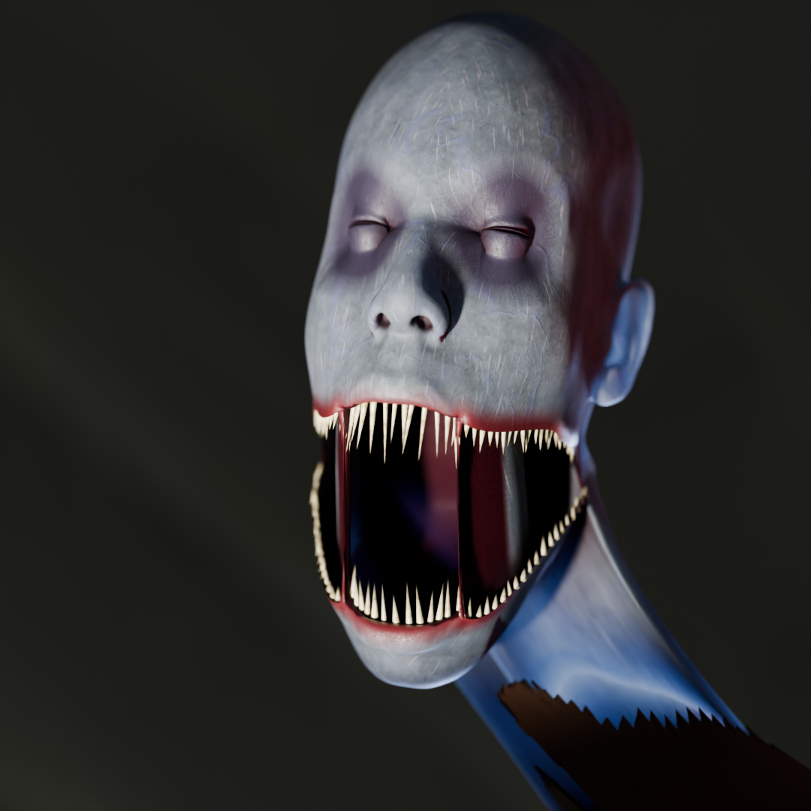
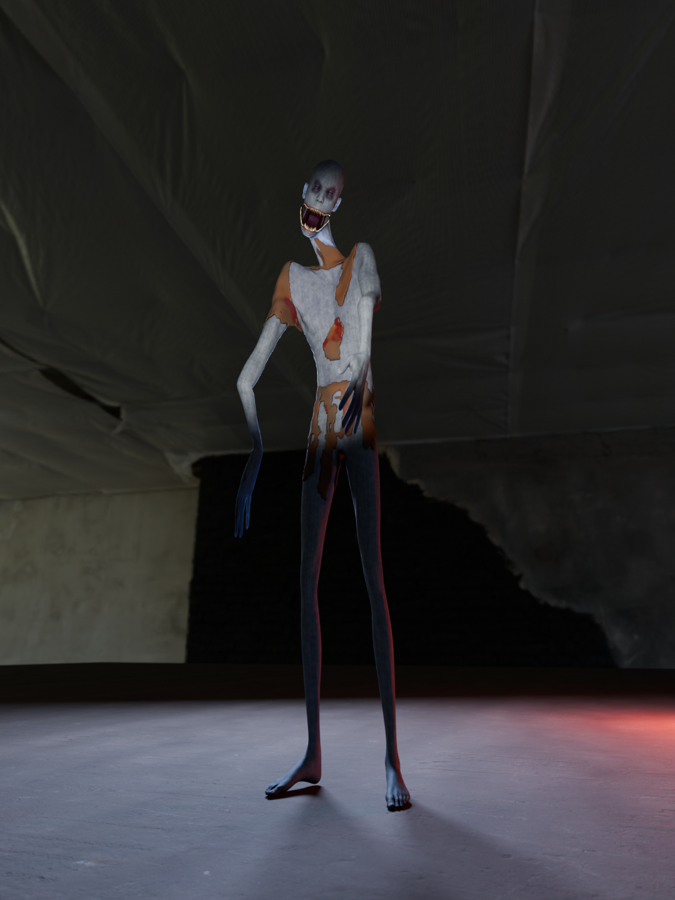
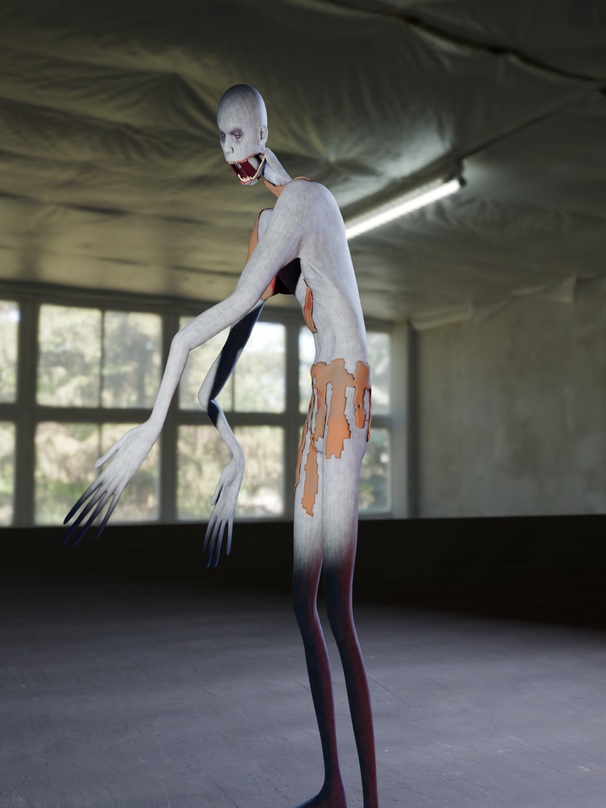

  

<h1 align="center">Overstretched</h1>

<i>A Lethal Company mod. Something tall is working your shift.</i>

---

## Install (the easy way)

1. Download **`OverstretchedInstaller.exe`** from the [latest release](https://github.com/PsychyBruh/Overstretched/releases/latest).
2. Run it. It finds Lethal Company through Steam on its own.
3. Click **INSTALL**. It sets up BepInEx (the mod loader) if you don't have it, then installs the mod.

Later, open it again and click **UPDATE** when a new version is out, or **UNINSTALL** to remove it.

> **Windows may say "Windows protected your PC".** The installer isn't code-signed (that costs money).
> Click **More info → Run anyway**. The full source is in this repo if you want to check it.

**Everyone in your lobby needs Overstretched installed.**

Manual install

1. Install [BepInEx 5](https://github.com/BepInEx/BepInEx/releases) into your Lethal Company folder.
2. Download `Overstretched.dll` from the latest release.
3. Put it in `Lethal Company/BepInEx/plugins/Overstretched/`.

## The Stretched

 

A company employee that got pulled into something much longer. It marks one of you when it arrives.

- **The silence.** When it's near, the world goes quiet, friends' voices too. Your heartbeat doesn't.
- **You never see it walk.** While anyone is watching, it only moves when the lights flicker.
- **Don't stare.** Look at it too long and it's suddenly behind you.
- **Your flashlight lies.** Up close it only exists inside a beam.
- **It's in the doorway.** Look away, and it's in a closer one.
- **It listens.** Sprinting, shouting and dropped items bring it to you.
- **It's on the ceiling.** It waits above where you're about to walk.
- **It uses your friends.** It knocks on doors, puts their footsteps behind you, and repeats things
  they said over voice chat, from the dark.
- **The kill.** It lifts you into the ceiling. Your screen fades while you can still hear your friends.
  No body. Your walkie keeps breathing. Your name on the ship radar now follows *it*.
- **The ship isn't safe.** If the marked player hides in the ship late in the day, it knocks. Then it pries.
- **It learns.** Every escape makes it faster.
- **Light hurts it.** A flashlight in the face or turning the breaker back on drives it off. Briefly.

## The F8 menu

Press **F8** in game.

| Tab | What's in it |
|---|---|
| **Player** | Move speed, jump, infinite sprint, god mode, no fall damage, noclip, heal, teleport to ship |
| **Economy** | Set credits, set or complete the quota, scrap value and amount multipliers |
| **World** | Time speed, freeze clock, lights on/off/flicker, set weather |
| **Monsters** | **Spawned now**: every monster in the level with freeze, bring here, go to, kill, remove. **Spawn table**: per moon, turn monsters on/off, change their odds, add any monster to any moon |
| **The Stretched** | Live AI status, spawn it, preview all 28 animations, spawn weight, silence radius, aggression, speed |

Most tabs are host-only.

## Building from source

- Mod: `dotnet build Overstretched/Overstretched.csproj -c Release` (references your Lethal Company install
  and BepInEx; the path is set in the `.csproj`).
- Installer: `dotnet build Installer/OverstretchedInstaller.csproj -c Release`.
- The model pipeline is in `tools/stretched2/` (Blender 5.2 Python scripts, run in order `00` → `10`).
  It needs the free assets listed under credits, downloaded into `downloads/`.

This repo contains only original code and CC0-derived assets. It does **not** include any of Lethal
Company's code or assets; vanilla sounds the monster uses are borrowed from your own game at runtime.

## Credits

- **Base human mesh**: [Blender Studio Human Base Meshes](https://www.blender.org/download/demo-files/#assets) (CC0)
- **Skin textures**: *Human Materials 1* by britdawgmasterfunk on Sketchfab (CC0)
- **Fabric, HDRI and floor textures**: [Poly Haven](https://polyhaven.com) (CC0)
- **Mod loader**: [BepInEx](https://github.com/BepInEx/BepInEx) (LGPL-2.1)
- **Lethal Company** by Zeekerss. This is a fan mod, not affiliated with the game.

## License

[MIT](LICENSE)
